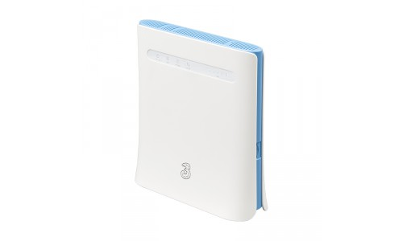

# NoobWRT for ZTE MF286D

**High-performance, fully customized OpenWrt firmware for the ZTE MF286D**

[Features](#-features) · [Install](#-quick-install) · [Device defaults](#-device-defaults) · [Documentation](#-documentation) · [Support](#-support)

---

## 📥 Download

**Maintainer builds are delivered privately in Google Drive:**

Select an unused **build_tag** in Actions → Build Firmware. Files are unzipped at
`ROOT/passwall1/<build-tag>/`: open `images/` for individual firmware images,
`metadata/` for build details, and `logs/` for logs. Checksums, result and
completion receipt sit in the build-tag folder. Access remains private; see
[setup and verification](docs/build-dispatch.md). No GitHub Actions artifacts or
releases are created by this build workflow.

> [!IMPORTANT]
> Read the release notes before upgrading. Each release lists its build info, image variants and any **known issues** with workarounds.

---

## Firmware source and contributions

Firmware definitions, package selections, filesystem overlays and device-specific hooks are maintained in [`firmware/`](firmware/). Propose firmware changes here, not in the builder repository. See [CONTRIBUTING.md](CONTRIBUTING.md).

The separate [NoobWRT builder](https://github.com/NoobWRT/noobwrt-builder) provides the build engine and runner. Maintainers request builds from this repository's **Actions → Build Firmware** workflow; results are tied to exact firmware and builder commits. See [build dispatch and verification](docs/build-dispatch.md).

This repository ships one reviewed variant: **ZTE MF286D / PassWall 1**.

## ✨ Features

- **Up-to-date OpenWrt base** (25.12.x, `ipq40xx/generic`) with security patches and bug fixes
- **PassWall 1** with the Xray core fetched into RAM at boot (fits the 29 MiB flash)
- **Cellular modem management** via ModemManager, QMI/MBIM protocols, `sms-tool-js` and `3ginfo-lite`
- **APN web page** at `http://192.168.1.1/apn.html` for quick APN / PDP changes
- **WireGuard**, `dnsmasq-full`, nftables firewall4 and PassWall's tproxy kernel modules
- **Lean footprint** for the 29 MiB firmware partition — no NAS/Samba/media packages
- **Small toolset:** `jq`, `curl`, `wget-ssl`, `wireguard-tools`
- **SMS LED helper** and band-lock defaults carried over from the reference MF286D image
- **NoobWRT theme** enabled by default (toolbar tuned to this build's apps)

## 🚀 Quick Install

Upgrading from an existing OpenWrt / NoobWRT installation, use the **sysupgrade** image (`.bin`):

1. Open `http://192.168.1.1` and go to **System → Backup / Flash Firmware**.
2. Create a backup of your current settings.
3. Upload the `sysupgrade.bin` image and confirm.
4. Wait for the router to reboot, then log in again at `http://192.168.1.1`.

**Coming from the official ZTE firmware?** The router cannot take a sysupgrade image
directly. Use the [Installation guide](docs/installation.md) — serial console + TFTP.

> [!CAUTION]
> Flashing third-party firmware may void your warranty and can brick your device if interrupted. Ensure stable power and proceed at your own risk. If something goes wrong, see the [Recovery guide](docs/recovery.md).

---

## ⚙️ Device defaults

The overlay in `firmware/devices/zte-mf286d/variants/passwall1/files/` is taken from the
reference ZTE MF286D image and reproduces its defaults:

| Setting | Value |
|---|---|
| LAN | bridge `br-lan` on `lan2 lan3 lan4`, `192.168.1.1/24` |
| WAN | `lan1` (Ethernet WAN) |
| Modem | QMI on `/dev/cdc-wdm0`, APN `internet`, IPv4 |
| WiFi 2.4 GHz | `radio0`, channel 8, HT20, SSID `OpenWrt-2.4Ghz` |
| WiFi 5 GHz | `radio1`, channel auto, VHT80, SSID `OpenWRT-5Ghz` |
| Country | `IT` (change in LuCI → Network → Wireless) |
| SSH | dropbear on port 22, password auth enabled |
| LuCI | **NoobWRT theme** (default), port 80/443 |

Change the WiFi country before using the router outside Italy.

---

## 📚 Documentation

Full documentation: **[mf286d-docs.pages.dev](https://mf286d-docs.pages.dev)**

| Guide | Description |
|---|---|
| [Getting Started](docs/getting-started.md) | First steps after flashing |
| [Installation](docs/installation.md) | Flash via U-Boot, web UI or CLI |
| [Recovery](docs/recovery.md) | Unbrick and restore your router |
| [UART Guide](docs/uart-guide.md) | Serial console access (X8 connector) |
| [Modem Firmware](docs/modem-firmware.md) | Modem information for the MF286D |
| [Hardware](docs/hardware.md) | MF286D hardware specifications |
| [Packages](docs/packages.md) | Included packages |
| [Additional Packages](docs/additional-packages.md) | Extending the image |
| [FAQ](docs/faq.md) | Common questions and fixes |

---

## 🛟 Support

Found a bug or need help? [Open an issue](https://github.com/nooblk-98/noobwrt-zte-mf286d/issues) and include:

- Firmware build tag and variant
- What you expected vs. what happened
- Relevant logs (**Status → System Log** / **Kernel Log**) and screenshots

Before opening an issue, check the [FAQ](docs/faq.md) and the known issues in the latest release notes.

---

## 🙏 Credits

This firmware is compiled and maintained by **Lahiru Sandaruwan ([NoobLK](https://www.linkedin.com/in/lahiru-sandaruwan-liyanage/))** .

NoobWRT is **free and open source**, built for the community. Please do not sell this firmware or any derivative of it; it should remain free for everyone.

Device defaults were mirrored from the community image by
[ilblogdicristiangallo](https://github.com/ilblogdicristiangallo/ZTE-MF286D-OpenWrt-25.12.4-by-ilblogdicristiangallo),
and the modem LuCI apps come from [4IceG](https://github.com/4IceG).

If you find this project useful, please ⭐ [star the repository](https://github.com/nooblk-98/noobwrt-zte-mf286d)!

## License

Based on [OpenWrt](https://openwrt.org) and distributed under the [GPL-2.0](docs/license.md) license.
