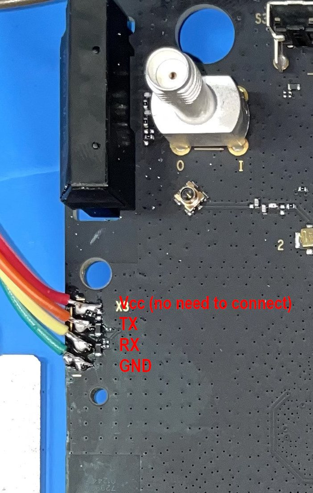
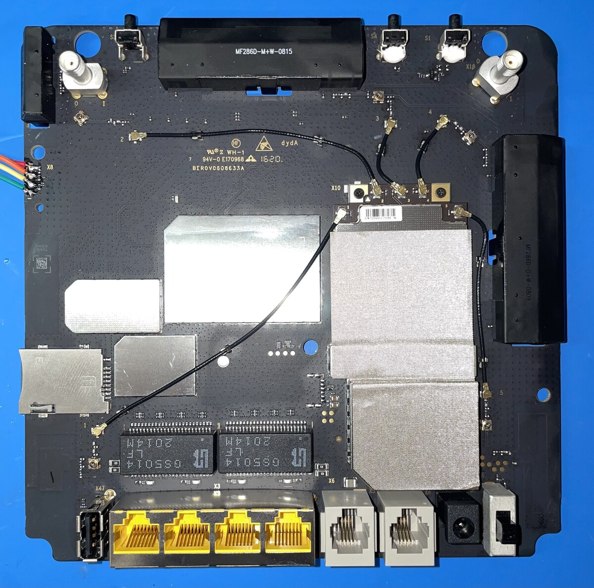

# Installation

This page covers both cases:

- **A router still on the official ZTE firmware** — serial console + TFTP first, then
  the OpenWrt/NoobWRT image.
- **A router already running OpenWrt / NoobWRT** — a normal sysupgrade.

!!! info "Official reference"
    The serial and install procedure follows the upstream OpenWrt device page:
    **[openwrt.org/toh/zte/mf286d](https://openwrt.org/toh/zte/mf286d)**. Photos are
    from that page (CC BY-SA). If anything here disagrees with the wiki, the wiki is
    authoritative.

!!! note "Before you flash"
    - Back up the original partitions if you may ever want to return to stock.
      At minimum: `mtd2` (MAC/ART), `mtd8` (`web`), `mtd9` (`rootfs`).
    - Use a stable power supply. The MF286D has no battery backup.
    - Keep the SIM out until the router boots OpenWrt for the first time.

## Flash layout (for backups)

```text
"nand":
0x000000000000-0x0000000a0000 : "fota-flag"
0x0000000a0000-0x000000120000 : "ART"
0x000000120000-0x0000001a0000 : "mac"
0x0000001a0000-0x000000260000 : "reserved2"
0x000000260000-0x000000660000 : "cfg-param"
0x000000660000-0x000000a60000 : "log"
0x000000a60000-0x000000b00000 : "oops"
0x000000b00000-0x000001000000 : "reserved3"
0x000001000000-0x000001800000 : "web"
0x000001800000-0x000003500000 : "rootfs"
0x000003500000-0x000004e00000 : "data"
0x000004e00000-0x000008000000 : "fota"
```

Back up from a root shell (stock or OpenWrt):

```sh
cat /proc/mtd
dd if=/dev/mtd2 of=/tmp/mtd2.bin     # MAC / calibration
dd if=/dev/mtd8 of=/tmp/mtd8.bin     # stock web UI
dd if=/dev/mtd9 of=/tmp/mtd9.bin     # stock rootfs
```

Copy them off the device. `mtd2` is the only copy of your MAC address.

---

## A. From stock ZTE firmware — serial console + TFTP

This is the upstream OpenWrt procedure and the only supported way off the stock
firmware. You need a 3.3 V USB-serial adapter, a TFTP server, and an **initramfs**
image.

### What you need

| Item | Detail |
|---|---|
| Adapter | USB-to-serial, **3.3 V** (CP2102, FT232RL, CH340 set to 3.3 V) |
| Wires | 3 dupont leads (TX, RX, GND) — VCC is not used |
| Console | `picocom`, `minicom`, PuTTY or `screen` |
| TFTP server | serves the initramfs image |
| Tools | PH1/PH2 screwdriver, plastic pry tool, anti-static surface |

!!! warning "3.3 V only"
    A 5 V TTL adapter can damage the SoC. Never connect the VCC pin — the router is
    powered from its own supply.

### 1. Open the case

From the official page (skip steps 1–2 on units without a battery lid):

1. Take off the battery lid. The battery cage is a dummy — this model has no battery.
2. Unscrew the screw behind the battery lid.
3. Take off the back cover; it is held by plastic clamps.
4. Unscrew the four screws hidden behind the back case.
5. Remove the front panel from the blue chassis (more plastic clamps).
6. Unscrew the two screws securing the PCB.
7. Lift the board out of the blue chassis.

More photos: [case opened](https://openwrt.org/_media/media/zte/mf286d/mf286d-8.jpg),
[main PCB](https://openwrt.org/_media/media/zte/mf286d/mf286d-10.jpg),
[PCB details](https://openwrt.org/_media/media/zte/mf286d/mf286d-12.jpg).

### 2. Connect the serial console

`X8` is a 4-pin header on the left edge of the main PCB, next to the blue chassis
edge and roughly level with the middle of the board.



| Pin | Signal | Note |
|---|---|---|
| 1 | VCC (3.3 V) | **do not connect** |
| 2 | TX | → adapter RXD |
| 3 | RX | → adapter TXD |
| 4 | GND | → adapter GND |

Board overview — `X8` at the left edge:



!!! note "Wire colours"
    The photo shows red = VCC, orange = TX, yellow = RX, green = GND. That is just how
    the wiki author wired it — follow the **pin order**, not the colours.

Serial settings: **115200 baud, 8 data bits, no parity, 1 stop bit (8N1)**

```sh
picocom -b 115200 /dev/ttyUSB0
```

If you see nothing, swap TX and RX.

### 3. Get an initramfs image

Every NoobWRT build publishes one next to the sysupgrade image:

```text
openwrt-ipq40xx-generic-zte_mf286d-initramfs-zImage.itb
```

This is the same image the wiki lists as *Firmware OpenWrt Install*. If you only have
an older release, use the matching file from
[downloads.openwrt.org](https://downloads.openwrt.org/releases/) for `ipq40xx/generic`.

Place it in the root of your TFTP server. This example uses `192.168.1.3` for the
server and `192.168.1.72` for the router.

### 4. Boot the initramfs from U-Boot

Connect the TFTP host to **`lan2`, `lan3` or `lan4`** — do **not** use the shared
WAN/LAN1 port. Power on and press **ESC** to stop U-Boot:

```text
setenv serverip 192.168.1.3
setenv ipaddr 192.168.1.72
set fdt_high 0x85000000
tftp openwrt-ipq40xx-generic-zte_mf286d-initramfs-fit-zImage.itb
bootm $loadaddr
```

### 5. Remove the stock UBI volumes

Log in over SSH or serial (the initramfs runs from RAM):

```sh
ubiattach -m 9
ubirmvol /dev/ubi0 -N ubi_rootfs
ubirmvol /dev/ubi0 -N ubi_rootfs_data
```

`ubiattach` may report an error if UBI was already attached; that is harmless.
`ubirmvol` may fail on `ubi_rootfs_data` if the stock firmware did not create it.

### 6. Install the NoobWRT image

```sh
sysupgrade -n /tmp/openwrt-ipq40xx-generic-zte_mf286d-squashfs-sysupgrade.bin
```

An `ubi attach` error during the flash can be ignored while the process continues.

!!! tip "One step, not two"
    You do **not** have to install official OpenWrt first. NoobWRT is built for the same
    `ipq40xx/generic` `zte_mf286d` profile with the same partition layout, so
    `sysupgrade -n` can flash the NoobWRT image directly from the initramfs.

    If you prefer, flash the official OpenWrt sysupgrade image first, boot it once, then
    sysupgrade to NoobWRT — same result, one extra reboot.

### If NAND errors appear

Two symptoms mean `/dev/mtd9` needs formatting:

```text
ubi0 warning: ... error -74 (ECC error) while reading 64 bytes from PEB 169:2048
```

or on reboot the router stops in U-Boot with:

```text
Nand Flash error. Status = 12336 NAND page read failed
```

Boot the factory/initramfs image again and run:

```sh
ubidetach -m 9
ubiformat -y /dev/mtd9
sysupgrade -n openwrt-ipq40xx-generic-zte_mf286d-squashfs-sysupgrade.bin
```

### Installing from LuCI instead

With the router booted from the initramfs and the PC on Ethernet, open
`http://openwrt.lan` (or `http://192.168.1.1`), leave the password blank and log in,
then use **System → Backup / Flash Firmware** with the sysupgrade image.

---

## B. From existing OpenWrt / NoobWRT — sysupgrade

Use `openwrt-ipq40xx-generic-zte_mf286d-squashfs-sysupgrade.bin`.

### Web UI

1. Log in at `http://192.168.1.1`.
2. Go to `System` then `Backup / Flash Firmware`.
3. Upload the image.
4. Untick `Keep settings` if you are coming from a different firmware.
5. Confirm and wait for the reboot.

### CLI

```sh
scp openwrt-ipq40xx-generic-zte_mf286d-squashfs-sysupgrade.bin root@192.168.1.1:/tmp/
sysupgrade -T /tmp/openwrt-ipq40xx-generic-zte_mf286d-squashfs-sysupgrade.bin
sysupgrade -n /tmp/openwrt-ipq40xx-generic-zte_mf286d-squashfs-sysupgrade.bin
```

!!! danger "`-n` erases all settings"
    `sysupgrade -n` erases all settings, including PassWall nodes and Wi-Fi. Drop `-n`
    to keep your settings.

If `sysupgrade -T` reports that the device is not supported, do **not** force the
flash. Use path A instead.

---

## After installation

1. Open `http://192.168.1.1` (LAN ports `lan2`–`lan4`, or the Wi-Fi AP).
2. Set the root password immediately — the shipped config has none.
3. Set the correct Wi-Fi country and key. The reference defaults use country `IT` and
   open Wi-Fi.
4. Configure the APN: `http://192.168.1.1/apn.html`, or LuCI →
   `Network` → `Interfaces` → `wan`. Defaults are QMI on `/dev/cdc-wdm0`, APN
   `internet`, IPv4.
5. **PassWall core:** on first boot the router downloads the Xray core into RAM
   (`/tmp/xray`). It needs working WAN for about a minute; check
   `logread -e passwall-core`. See [Packages](packages.md#passwall-core-downloaded-into-ram-at-boot).
6. If the LTE link is unstable, update the modem firmware to **B12** first (see
   [Modem Firmware](modem-firmware.md)). Stay on B12 — B14 is reported to break QMI.

If something goes wrong, follow [Recovery](recovery.md).
