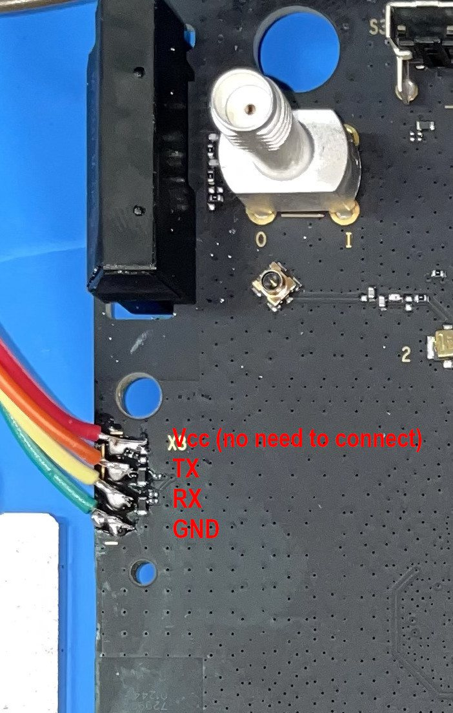
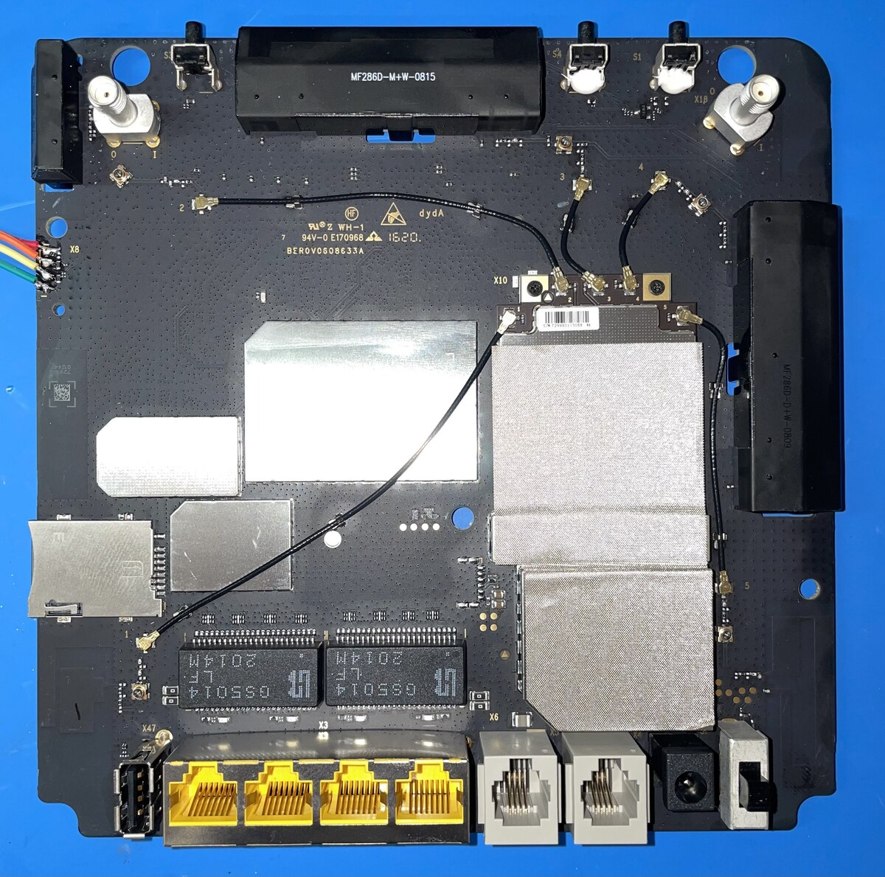

# UART Guide

The ZTE MF286D exposes a serial console on the internal **X8** header. It is the
recovery path when the router does not boot, and the required path for first-time
installation.

## Connector

X8 is a 4-pin header on the left edge of the main PCB (the side with the USB port
and the reset button), next to the blue chassis edge.



Pin order, from the pin closest to the `X8` silkscreen label to the farthest:

| Pin | Signal | Wire in the photo |
|---|---|---|
| 1 | VCC (3.3 V) — **do not connect** | red |
| 2 | TX | orange |
| 3 | RX | yellow |
| 4 | GND | green |

Board overview — `X8` sits at the left edge, roughly level with the middle of the
board:



!!! note "Photo credits"
    Both photos are from the [OpenWrt wiki device page](https://openwrt.org/toh/zte/mf286d)
    (CC BY-SA) and are reproduced here for offline reference.

## Serial settings

```text
115200 baud, 8 data bits, no parity, 1 stop bit (8N1)
```

Use a **3.3 V** USB-to-serial adapter (for example a CP2102 or FT232RL board set to
3.3 V). Do not connect the VCC pin; power the router from its own supply.

## Wiring

| Adapter | Router X8 |
|---|---|
| GND | Pin 4 (GND) |
| RXD | Pin 2 (TX) |
| TXD | Pin 3 (RX) |

If you see nothing, swap TX and RX.

## Accessing U-Boot

1. Open a serial terminal at `115200 8N1`.
2. Power on the router and press a key repeatedly to interrupt autoboot.
3. You should get the U-Boot prompt.

From U-Boot you can load an initramfs image over TFTP and boot it:

```text
setenv serverip 192.168.1.3
setenv ipaddr 192.168.1.72
set fdt_high 0x85000000
tftp openwrt-ipq40xx-generic-zte_mf286d-initramfs-fit-zImage.itb
bootm $loadaddr
```

## Opening the case

From the upstream support commit:

1. Remove the battery lid (the battery cage is a dummy on this model).
2. Unscrew the screw behind the battery lid.
3. Remove the back cover; it is held by plastic clamps.
4. Unscrew the four screws hidden behind the back case.
5. Remove the front panel from the blue chassis (more plastic clamps).
6. Unscrew the two boards securing the PCB.
7. Lift the board out of the chassis.

The X8 header is on the main board. Work on an anti-static surface.
